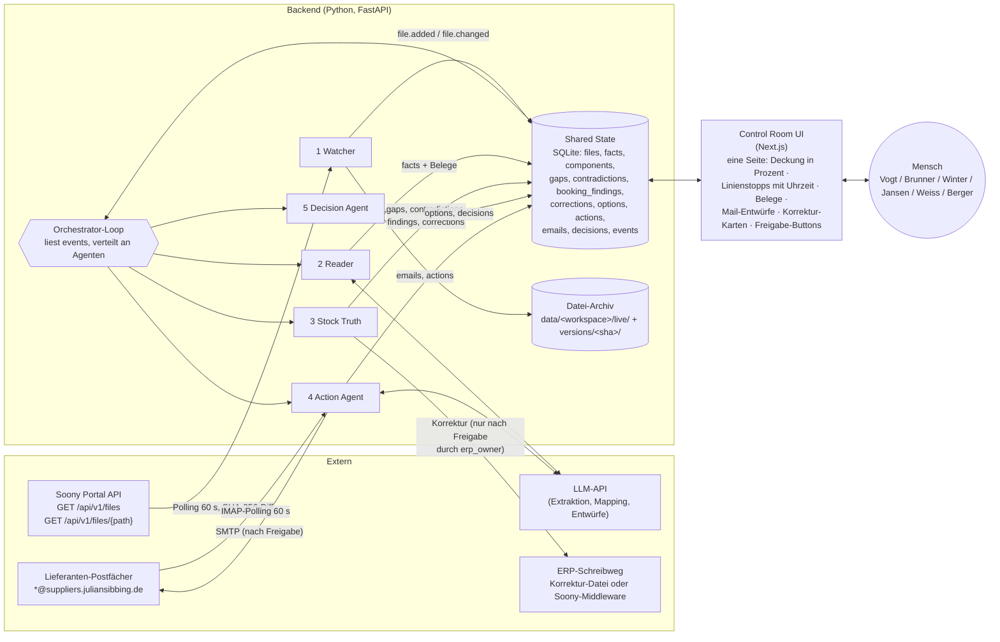
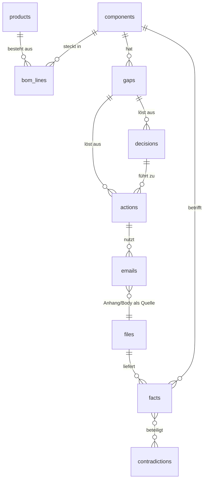
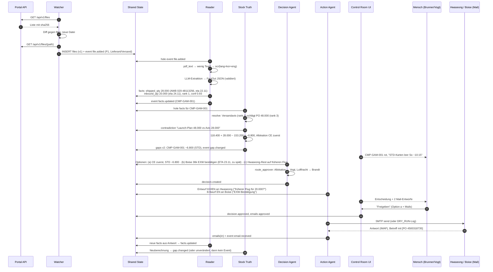

# Lineguard – Technische Architektur

**Team TRIPLET · START Hack Munich 2026 · Lio-Case „Keep the Line Running“**
Stand: Sa 21.11.2026, 22:45 (Europe/Berlin). Daten geprüft gegen den Portal-Stand von 18:15 (318 Dateien) und von 22:45 (332 Dateien, Nachtrag zu §0a). Ergänzt um das Gespräch mit Nils Berger und die Entscheidungen von 19:55 (§0b) und um die Prüfung der Skalierung von 20:20 (`docs/skalierung.md`) · Abgabe: **So 22.11., 12:00** · Launch: **So 22.11., 20:00**

**Lineguard** ist das Produkt: Es hält eine Linie mit fester Frist am Laufen, für jede Firma mit Stückliste und Lieferanten. **Launch Control Room** ist der Einsatz von Lineguard bei Soony. Alles, was nur für Soony gilt, steht im Kundenpaket und nicht im Kern (`docs/kern-und-kundenpaket.md`).

> **Leitfrage:** *Schaffen wir Sonntag 20:00, und was bricht zuerst?*
> Lineguard beantwortet die Frage live aus allen Quellen und **handelt**: Es schreibt Lieferanten an, bereitet Entscheidungen mit Preis vor und lässt sie vom richtigen Menschen freigeben.
> **Ziel:** 100 % Deckung der gesamten Nachfrage zur Frist. Bei Soony: alle 712.000 Kopien.

Kontext-Dateien: `../analysis.md`, `../out/component_gap.csv`, `../out/issues.csv`, `../out/open_pos.csv`, `../openapi.json`, `../poll_drops.py`. Diese Dateien liegen **nicht im Repo**. Wer sie hat, legt die Skripte (nicht die Daten) ins Repo.

**Weitere Spezifikationen.** Dieses Dokument ist der Überblick. Lies die passende Datei, bevor du den Teil baust:

| Datei | Lies sie, wenn du … |
|---|---|
| `docs/umsetzung.md` | mit dem Bauen beginnst: Reihenfolge der Schritte und Fertig-Kriterium je Schritt |
| `docs/kern-und-kundenpaket.md` | eine Datei unter `lineguard/` oder `packs/` anlegst oder einen Kundenwert (Teil, Lieferant, Person, Menge, Datum, Grenzwert) in den Code schreiben willst |
| `docs/buchungspruefung.md` | die Prüfung der Wareneingänge, die Korrektur-Karte für den `erp_owner` oder den Schreibweg ins ERP baust |
| `docs/lueckenschluss.md` | Optionen, Pläne, Eskalation oder die Kopfzeile mit der Deckung in Prozent baust |
| `docs/dauerbetrieb.md` | den Rechenkern, die Wächter, die Tabelle `cases` oder die Liste „Danach“ baust: Lineguard nach der ersten Frist |
| `docs/betrieb-und-wartung.md` | Freigabe-Endpunkte, Migrationen, CI, Prompts oder das LLM-Modell anfasst, einen Erweiterungspunkt nutzt oder ein Paket für einen neuen Kunden anlegst |
| `docs/skalierung.md` | `db.py`, den Orchestrator, den ersten Import oder `/state` baust, oder wenn die Frage lautet, ob Lineguard bei mehr Kunden, mehr Daten oder mehr Entscheidungen trägt |
| `docs/import-und-routen.md` | `routes.yaml` oder `source_rank.yaml` schreibst oder den Reader baust: Tabellenarten, Regeln für Tabellen, Freitext, `docx`, fremder Inhalt, die Dateien von Soony, Vorlagen im Branch `origin/christian` |
| `docs/jury-und-pitch.md` | Deck, Demo-Skript oder README schreibst oder bei Zeitnot zwischen zwei Teilen wählen musst |

Bei einem Widerspruch gilt die Datei unter `docs/` für ihr Thema und dieses Dokument für alles andere.

---

## 0. Kurzfassung

| Was | Entscheidung |
|---|---|
| Produkt | **Lineguard** = **Stock Truth** (echte Deckung und Uhrzeit des Linienstopps) + **Buchungsprüfung** (Fehler beim Wareneingang sofort finden) + **Release Gate** (nur freigegebene Teile zählen) + **Supplier Chaser** (Agenten handeln per Mail) + **Decision Desk** (Freigaben nach den Regeln des Kunden). Einsatz bei Soony: „Launch Control Room“ |
| Ziel | 100 % Deckung der Nachfrage zur Frist, bei Soony alle 712.000 Kopien. Eine allgemeine Schleife schließt jede Lücke oder meldet sie offen als nicht schließbar (`docs/lueckenschluss.md`) |
| Kern und Kundenpaket | Kern `lineguard/` ohne Kundenwerte. Paket `packs/soony_gh6/` mit Frist, Nachfrage, Quellen, Grenzwerten und Freigaberegeln (`docs/kern-und-kundenpaket.md`) |
| ERP | Lesen aus Exporten. Schreiben nur als Korrektur mit Freigabe durch den `erp_owner` (bei Soony Nils Berger), über einen Adapter: Datei als Standard, Soonys Middleware sobald der Zugang da ist (`docs/buchungspruefung.md` §7) |
| Agenten | 5 Agenten mit eigenen Tools: **Watcher, Reader, Stock Truth, Action, Decision**. Buchungsprüfung und Lückenschluss sind Code in Stock Truth und Decision, keine neuen Agenten |
| Zusammenarbeit | Ein gemeinsamer Zustand (SQLite) + Event-Tabelle als Queue. Kein Agent ruft einen anderen direkt auf |
| Dauerbetrieb | Die Frist ist ein Bedarfstermin unter mehreren. Buchungsprüfung, Release Gate und Wächter laufen ohne Frist weiter. Was nach der Frist wirkt, ist ein Fall mit Besitzer und Datum in der Liste „Danach“ (`docs/dauerbetrieb.md`) |
| Wartung | Freigabe nur mit Person und Rolle, nummerierte Migrationen, CI bei jedem Push, Golden Set für die Lese-Qualität, Erweiterung über eine Datei plus Test (`docs/betrieb-und-wartung.md`) |
| Skalierung | Bis zur Abgabe nur die Nähte: Reader parallel, Events mit Claim und Partition, `workspace_id` in jeder Tabelle, neutrales Datenmodell, Speicher hinter Schnittstellen, Messwerte. Der Ausbau (Container je Kunde, Postgres, Push statt Polling) hat je Stufe einen Auslöser (`docs/skalierung.md`) |
| Default-Stack | **Python 3.11 · FastAPI · SQLite · eigener Orchestrator-Loop (asyncio) · Next.js** |
| Alternative | LangGraph statt eigenem Loop, Streamlit als Notlösung für die UI (siehe §7) |
| Demo-Fälle | Nach Wert sortiert (CPO-Memo: Collector's zuerst): (1) Artbook −5.900 CE · (2) Statue −3.400 CE · (3) Hüllen am CTA −32.000 STD · (4) Sleeves Rev. B: 64.000 sperren · (5) Spielkarten −6.800 STD · (6) Magnete: bewusst **kein** Alarm |
| Ausgabe | **Eine Seite**: was eine Linie stoppt, wann, und was es kostet (CPO-Memo: „One page per day … Not forty dashboards“) |
| Sicherheit | Mails standardmäßig `DRY_RUN`; jede Nicht-Routine-Mail und jede Entscheidung braucht einen Klick durch einen Menschen |

---

## 0a. Prüfung gegen die Portal-Daten (Sa 21.11., 18:15)

**Ergebnis:** Der Aufbau ist gut. Die vier Lücken-Zahlen stimmen mit den Rohdaten überein. Sechs Punkte ändern sich, weil seit Freitag neue Dateien da sind und weil das CPO-Memo die Rangfolge festlegt.

**Bestätigt (aus den Rohdaten nachgerechnet):**

| Teil | System sagt | Beleg sagt | Lücke |
|---|---|---|---|
| CMP-GAM-008 Artbook | 91.300 (GR 5000413065 = 80.000) | Lieferschein WZ-261116-473: „80.000“ gestrichen, „8 000“ von Hand, 360 kg, 40 Packstücke → 19.300 | **−5.900 CE** |
| CMP-GAM-010 Statue | 27.400 frei | Prüfbericht 5000413063: Charge 5.600 fällt durch (9 von 125) → 21.800 | **−3.400 CE** |
| CMP-GAM-003 Hülle | 96.000 + 350.000 „due“ | Container NHSU4471921 liegt seit 20.11. am CTA, kein Wareneingang | **−32.000 STD** |
| CMP-GAM-001 Spielkarte | 118.400 + 48.000 | Versandavis: 28.000 geflogen, 20.000 erst am 24.11. | **−6.800 STD** |

**Änderungen:**

1. **Neuer Ausgangsstand.** `soony/context/launch_status.xlsx` (Sa 13:00): noch zu packen **86.000 STD** und **18.900 CE**. Die Zahlen 128.000 / 25.200 sind der Stand von Freitag. Stock Truth liest den Restbedarf aus der jeweils neuesten Status-Datei und rechnet den Bestand weiter (§2.3). Die Lücken in Stück bleiben gleich, aber die Uhrzeiten ändern sich.
2. **Uhrzeit statt nur Stückzahl.** Die Antwort auf „Was bricht zuerst?“ ist eine Uhrzeit. Aus Bestand, Packrate und Schichtplan folgt (Stand Sa 13:00): Hüllen leer **Sa 22:00** (Standard-Linien stehen ab So 06:00) · Sleeves Rev. C leer **So 10:20**, falls der Nowak-Lkw nicht kommt · Artbook leer **So 11:27** · Statue leer **So 14:13**.
3. **Sleeves sind ein geklärter Fall, kein offener Widerspruch.** `bom_delta_2026-11-21.csv` (ECN-2026-118): Rev. B darf nicht gepackt werden. Die Auftragsbestätigungen zeigen: Charge 5000413064 (64.000, PackRight, OA26182346) ist **Rev. B**, die Nowak-Chargen (122.000) sind Rev. C. Nutzbar sind also 122.000 statt 186.000. Das ist ein Release-Gate-Fall mit hohem Wert und fast ohne Kosten.
4. **Magnete sind kein Launch-Problem.** CMP-MAG-005 steht mit Bestand 0 in der Stückliste (4 pro CE, rechnerisch −100.800). PackRight baut die Magnete in die Box ein, sie werden nie einzeln gebucht (`suppliers/SUP-0029_…/components.csv`). Die Export-Meldung betrifft Lieferungen ab Dezember. Das System darf hier **nicht** rot werden.
5. **Rangfolge nach Wert.** `memo_launch_priorities.docx` (CPO, 21.11.): Collector's zuerst, auch bei Spielkarten. Eine fehlende vorbestellte Kopie wird erstattet und kostet den Kunden. Eine Standard-Kopie am Dienstag wird noch verkauft. Deshalb ist das Artbook der Leitfall, nicht die Spielkarte.
6. **Umfang passt nicht in die Restzeit.** Bis zur Abgabe sind es knapp 18 Stunden. §9 ist gekürzt, echte Lieferanten-Mails gehen schon heute Abend raus (§9).

**Nach dem Launch (im System Fälle in der Liste „Danach“ mit Besitzer und Datum, `docs/dauerbetrieb.md` §6; keine Mail vor Sonntag):** 675.000 Sleeves Rev. B in offenen PackRight-Bestellungen (4500318752, -765, -774, -786) · Magnet-Engpass für Boxen ab Dezember · Hwaseong-LTA läuft am 31.12.2026 aus, Verlängerung bis 15.12. · Pune-Conditional-Release abgelaufen.

**Nachtrag Sa 21.11., 22:45 (Portal-Stand mit 332 Dateien, von Hand nachgerechnet):**

1. **Neuester Stand.** `soony/erp/stock_update_2026-11-21.xlsx` (Sa 20:50): gepackt 602.000 STD und 60.300 CE. Noch zu packen: **38.000 STD** und **11.700 CE**. Die Zahlen 86.000 / 18.900 aus Punkt 1 sind der Stand von Sa 13:00. Die Datei liegt unter `soony/erp/` und heißt nicht `launch_status`: Der neueste Stand gewinnt über `as_of`, nicht über den Dateinamen (`docs/import-und-routen.md` §3, Regel 12).
2. **Lücken in Stück unverändert.** Artbook −5.900, Statue −3.400, Hüllen −32.000, Spielkarten −6.800. Rechnung: Buchbestand 77.800 / 13.900 / 6.000 / 42.900 gegen Bedarf 11.700 / 11.700 / 38.000 / 49.700, beim Artbook minus 72.000 falsch gebucht, bei der Statue minus 5.600 durchgefallen. Die Uhrzeiten aus Punkt 2 und aus §5 gelten nicht mehr. Stock Truth rechnet sie aus dem neuen Stand.
3. **Zwei Sendungen sind da.** `goods_receipts_update.csv` bucht am 21.11. 28.000 Spielkarten (5000413070) und den Nowak-Lkw mit 20.000 Sleeves (5000413071). `open_shipments.csv` ist seit dem 20.11. unverändert und zeigt beide weiter als `booked`. Zulauf zählt deshalb nur mit der offenen Menge der Bestellposition (Regel 11).
4. **Sleeves.** Buchbestand 116.000, ohne Chargen. Abzuziehen sind 64.000 Rev. B, falls die Charge noch am Lager liegt, und 4.000 Stück eines anderen Teils auf einer falsch beschrifteten Palette des Nowak-Lkw (Bemerkung der Buchung 5000413071, `docs/buchungspruefung.md` Prüfung 8). Nutzbar 48.000 gegen Bedarf 38.000. Welche Revision am Samstag verbraucht wurde, ist offen (§11, Frage 9).
5. **Neue Dateiarten.** JSON unter `soony/news/` und als `suppliers/*/profile.json`, dazu `components_delta.csv`. `profile.json` von Pune nennt das Ende der bedingten Freigabe als Feld: 30.10.2026, nicht verlängert.
6. **Was das System jetzt selbst zeigt.** Der Buchbestand zeigt die Lücken bei Hüllen und Spielkarten offen. Artbook, Statue und Sleeves sieht nur, wer Belege liest. Die Magnete stehen im Buch bei −46.800 und sind kein Problem (Punkt 4).

---

## 0b. Neue Eingaben und Entscheidungen (Sa 21.11., 19:55)

### Gespräch mit Nils Berger (IT & Systems Lead, Soony)

Das Gespräch liegt als automatische Mitschrift vor. Unklare Stellen sind markiert.

| Aussage von Nils | Folge für die Architektur |
|---|---|
| Ein falscher Bestand in SAP fällt erst auf, wenn das Teil wieder gebraucht wird. Das dauert ein paar Tage bei vielen Bestellungen, sonst auch Monate | Buchungsprüfung bei jedem Wareneingang (`docs/buchungspruefung.md`). Zählung anfordern, wenn die Deckung dünn und die letzte Zählung alt ist (`docs/lueckenschluss.md` §7) |
| 80.000 statt 8.000 ist „der Klassiker“: eine Null zu viel getippt, Faktor 10. Das ist kein Einzelfall. An welcher Stelle der Fehler entsteht (Fahrer, Lieferant, Buchung), weiß er nicht | Ursache `decimal_shift` als eigene Regel. Die Prüfung vergleicht mehrere unabhängige Quellen, weil der Ort des Fehlers offen ist. Der Artbook-Fall (§5, Fall 1) ist genau dieser Fehler |
| Der Wareneingang wird von Hand gebucht | Jede Buchung wird gegen Bestellung, Lieferschein, Gewicht und Packstücke geprüft |
| Nur Nils darf Daten im ERP korrigieren. Bei einem Fehler suchen Leute in Mails und Telefonnotizen oder schauen im Lager nach, dann korrigiert er | Rolle `erp_owner`. Lineguard sammelt die Belege selbst und legt eine fertige Korrektur-Karte vor. Ein Klick gibt sie frei |
| Die Korrektur passiert sofort, wenn es dringend ist, sonst auch erst zwei Wochen später | Stock Truth rechnet sofort mit der belegten Menge und wartet nicht auf die Korrektur im ERP. Die Karte zeigt ihr Alter |
| Die Korrekturen kosten ihn „fast alles“ an Zeit. Er würde lieber Software bauen und Daten prüfen. Eine Stundenzahl nannte er nicht | Kennzahlen im System: Zeit bis zum Fund, Zeit bis zur Korrektur, Anzahl der Befunde (`docs/buchungspruefung.md` §8). Die Stundenzahl ist eine offene Frage (§11, Frage 16) |
| SAP ist „heilig“. Für das Schreiben kann eine Middleware benutzt werden. **Unklar in der Mitschrift:** ob es sie schon gibt, und wie Endpunkt und Zugang aussehen | Port `ErpWriter` mit zwei Implementierungen. Standard ist die Korrektur als Datei. Die Middleware kommt dazu, sobald Nils Endpunkt und Zugang nennt (§11, Frage 15) |
| Ob Soony schon einmal versucht hat, Fehler automatisch zu finden: **keine klare Antwort in der Mitschrift** | Offene Frage (§11, Frage 17). Der Pitch behauptet dazu nichts |

### Entscheidungen des Teams

1. **Ziel 100 %.** Die Architektur muss dafür sorgen, dass alle Kunden ihr Spiel bekommen: alle 712.000 Kopien, auch Standard für Spontankäufe. Der Weg dahin ist eine allgemeine Schleife ohne Sonderregeln für Soony (`docs/lueckenschluss.md`). Das frühere Endbild der Demo („STD −6.800, nur Spontankäufe“) ist kein Ziel mehr: Die Schleife arbeitet an dieser Lücke weiter, bis sie geschlossen oder als nicht schließbar gemeldet ist.
2. **Produkt statt Projekt.** Das Team tritt als Firma mit einem Produkt auf, das Soonys Problem gelöst hat und für andere Firmen genauso läuft. Deshalb: neutraler Name Lineguard, Kern und Kundenpaket getrennt, ein zweites kleines Paket als Beweis (`docs/kern-und-kundenpaket.md`).
3. **Buchungsprüfung in kleiner Version.** Regeln im Stock-Truth-Handler, Korrektur-Karte für Nils, Rückblick über alle Wareneingänge. Kein neuer Agent. Aufwand etwa 2 Stunden (§9).
4. **ERP-Schreibweg.** Adapter mit Freigabe durch den `erp_owner`. Datei als Standard, Middleware als zweite Implementierung.

### Vier Sicherungen für 100 %

| Sicherung | Frage | Teil des Systems |
|---|---|---|
| Wahrheit | Stimmt der Bestand, mit dem wir rechnen? | Buchungsprüfung, Quellen-Rangfolge, Release Gate, Regel `thin_and_stale` |
| Plan | Hat jede Lücke einen Besitzer, einen Preis und eine Frist? | Lückenschluss im Decision Agent |
| Zeit | Kommt die Ware früh genug, um noch gepackt zu werden? | `breaks_at`, `latest_useful_arrival`, Vergleich `actual_rate` gegen `required_rate` |
| Nachhaken | Ist die Zusage belegt? | Action Agent mit Follow-up, Absicherung durch eine zweite Option, Eskalation an die nächste Rolle |

Software stellt keine Ware her. Kann eine Lücke nicht geschlossen werden, zeigt Lineguard den Rest offen mit Stückzahl, Grund und Plan für die Lieferung nach der Frist (`docs/lueckenschluss.md` §8).

### Aus den Unterlagen von Lio (Challenge-Brief und Jury-Kriterien)

Diese Punkte gelten als Anforderungen an den Bau. Die Zuordnung zu den Kriterien steht in `docs/jury-und-pitch.md`.

1. Agenten handeln: lesen, entscheiden, schreiben, eskalieren. Eine Anzeige über einer Tabelle reicht nicht.
2. Werkzeuge, Logik und Zustand statt eines großen Prompts.
3. Kein fest eingebauter Wert. Unordentliche, mehrsprachige (KO, ZH, PL, EN) und widersprüchliche Daten in mehreren Formaten.
4. Ein neuer Drop im Portal wird ohne Umbau verarbeitet. Drops kommen tagsüber und ohne Ankündigung.
5. Das Team kann erklären, was passiert, wenn das System falsch liegt (§6.6).
6. Ein Thema tief statt zehn Themen flach. Der Leitfall ist der Artbook-Fall mit Buchungsprüfung, Korrektur und Nachbestellung.
7. Eine Oberfläche, eine klare Empfehlung, ein Klick, ein gut gestalteter Moment für die Entscheidung des Menschen.
8. Lieferanten antworten nur auf Mails von Absendern, die im Portal unter Settings eingetragen sind.
9. Die Kundendaten bleiben im Team (§11, Frage 13).

---

## 0c. Klarstellung von Lio (Sa 21.11., 19:48) und Prüfung dagegen

Lio schrieb an alle Teams: Gesucht ist ein Produkt, das nach dem Wochenende weiterläuft und auch für andere Firmen gilt. Die Lösung muss wartbar sein und für lange Nutzung taugen. Die Probleme bei Soony sind konkret, andere Firmen haben dieselbe Art von Problem. Das Team wählt die Hauptprobleme bei Soony und löst sie so, dass die Lösung auf eine andere Firma übertragbar ist. Der gefährdete Launch ist der Fall, an dem das Produkt zeigt, was es kann. Der Pitch handelt vom Startup und vom echten Wert.

| Aussage | Stand vor der Prüfung (20:50) | Änderung |
|---|---|---|
| Für andere Firmen | Erfüllt: Kern ohne Kundenwerte, Kundenpaket, zweites Paket als Test | — |
| Hauptprobleme übertragbar lösen | Erfüllt: allgemeine Regeln, die sechs Fälle sind Ergebnisse (Tabelle unten) | — |
| Der Launch ist der Vorführfall | Erfüllt: §5 | — |
| Läuft nach dem Wochenende weiter | Zum Teil: Deckung und Lückenschluss hingen an genau einer Frist. „Nach dem Launch“ war ein Hinweis ohne Besitzer | `docs/dauerbetrieb.md`: Bedarfszeilen mit Termin, Wächter, Tabelle `cases`, Liste „Danach“ |
| Wartbar für lange Nutzung | Zum Teil: Tests, Konfiguration als Daten und Schnittstellen waren da. Es fehlten Anmeldung, Migrationen, CI, Messung der Lese-Qualität und ein Ablauf für neue Kunden | `docs/betrieb-und-wartung.md`: W1 bis W5, Erweiterungspunkte, Ablauf „Neuer Kunde“ |
| Pitch über das Startup und den Wert | Offen: Es gibt die Jury-Kriterien, aber keine Geschichte der Firma, kein Preismodell, keinen Zielkunden | Zurückgestellt bis nach dem Bau (§11, Frage 23) |

Die Hauptprobleme bei Soony und ihre allgemeine Form:

| Bei Soony | Allgemeines Problem | Teil von Lineguard |
|---|---|---|
| 80.000 Artbooks gebucht, 8.000 geliefert. Fällt erst an der Linie auf, nur Nils darf korrigieren | Von Hand gebuchte Bestände sind falsch, und der Fehler wird spät gefunden | Buchungsprüfung mit Korrektur fürs ERP |
| Lieferanten melden zu spät, 20 offene Sendungen in einer Tabelle, „We find out at the dock“ | Zusagen und Wirklichkeit laufen auseinander, niemand hakt rechtzeitig nach | Quellen-Rangfolge, Wächter, Action Agent |
| Sleeves Rev. B, durchgefallene Statuen-Charge | Nicht freigegebene Ware zählt im System als Bestand | Release Gate |
| Wer bestellt 8.000 Artbooks nach, bis wann, zu welchem Preis? | Entscheidungen unter Zeitdruck haben keinen Besitzer und keinen Preis | Lückenschluss mit Freigaberegeln als Daten |

---

## 0d. Abgleich mit dem Branch `origin/christian` (Sa 21.11., 22:20)

Auf dem Branch liegt das Paket `soony_tower` (Sa 20:12): Portal-Sync, Tabellen-Leser, Prognose, Dokument-Agent, Risiken, Mail-Agent, eine Seite. Das Team hat entschieden: Der Branch wird nicht gemergt. In den Plan kommt nur, was ihn besser macht.

| Übernommen | Wohin |
|---|---|
| Wissen über die Dateien: `day_one_qty`, `components_update_*.csv`, Spalten von `bom_delta`, Excel-Berichte mit Titelzelle und Kopfsuche, Sendungen ohne Menge, letzte Strecke vom Hafen | `docs/import-und-routen.md` §3, §7 |
| Erprobte Funktionen für Kodierung, Zahlen, Datum, Kopfsuche, Zuordnung von Antworten | `docs/import-und-routen.md` §8 als Vorlage |
| „System sagt“ neben „Lineguard sagt“ als zwei Zahlen je Produkt | `docs/lueckenschluss.md` §2, Stufe `system` |
| Uhr zum Zurückspulen (`--at`) | `lineguard/clock.py`, `LINEGUARD_NOW`, `/state?at=` (§10) |
| Fremder Inhalt: Anweisungen in Dokumenten nicht befolgen, Feld `suspicious`, Adressen nur aus Stammdaten, Kennungen aus LLM-Antworten prüfen | `docs/import-und-routen.md` §6, §6.6 |
| `docx` lesen (das Memo des CPO ist ein `docx`), Freitext-Spalten in Tabellen | `docs/import-und-routen.md` §4, §5 |
| Vorrang für Hinweise und Prüfberichte beim Lesen | `docs/skalierung.md` N1 |
| Stille Sendungen und veralteter Export als Wächter | `docs/dauerbetrieb.md` §5 |
| Antworten zuerst über `In-Reply-To` zuordnen, Anhänge lesen, Feld `commits_money` im Entwurf | §2.4, `docs/import-und-routen.md` §6 |
| Preis einer Stunde Stillstand auf der Entscheidung | `docs/lueckenschluss.md` §5 |
| `Dockerfile` und `render.yaml` als Vorlage für das Deployment | `docs/umsetzung.md`, Stufe C |

Nicht übernommen: der Zustand in JSON-Dateien statt Datenbank und Events · `risks.py` mit Regeln und Texten je Fall im Code · die Einstufung der Dringlichkeit durch das LLM · Produkte, Standort und Launch-Datum im Code und in den Prompts · die Bindung an Gemini · die Seite `cockpit/index.html`.

Zwei Annahmen im Branch widersprechen dem Plan und sind offene Fragen (§11, Frage 25): 4 Stunden vom Tor bis zur Linie (Plan: 2 Stunden) und 1 Tag für die Abholung am Hafen.

---

## 1. Systemüberblick



**Prinzip:** Jeder Agent liest Events aus der Tabelle `events`, arbeitet mit seinen Tools und schreibt Ergebnisse plus **neue Events** in den gemeinsamen Zustand. Dadurch entsteht die Kette *Datei → Fakt → Lücke → Entscheidung/Aktion → Mail → Antwort → Fakt …* ohne feste Abläufe. Neue Daten an beliebiger Stelle lösen automatisch eine Neuberechnung aus.

---

## 2. Agenten, Verantwortung und Tools

Jeder Agent ist ein **kleiner Tool-Use-Agent** (LLM mit 3–6 Funktionen) bzw. deterministischer Code, wo kein LLM nötig ist. Kein „Mega-Prompt“. Rechenlogik (Deckung, Lücken, Freigabegrenzen) ist **deterministischer Python-Code**, das LLM wird nur für Lesen, Zuordnen und Schreiben benutzt. So sind die Zahlen in der Demo reproduzierbar.

### 2.1 Watcher (deterministisch, kein LLM)

| | |
|---|---|
| Auftrag | Neue/ersetzte/gelöschte Dateien im Portal erkennen und archivieren |
| Trigger | Timer alle 60 s (konfigurierbar `POLL_SECONDS`) + manueller Button „Jetzt prüfen“ |
| Basis | `poll_drops.py` (existiert, wird zu `agents/watcher.py` umgebaut) |
| Tools | `list_files()` → `GET /api/v1/files` · `download(path)` → `GET /api/v1/files/{path}` · `verify_sha256(bytes, sha)` · `archive_version(path, old_sha)` |
| Schreibt | `files` (neue Version), `events` (`file.added` P2, `file.changed` **P1**, `file.removed` P2) |
| Regeln | Ersetzte Datei = **Priorität 1** (meist geänderte Menge/Termin). Alte Version bleibt unter `data/<workspace>/versions/<sha12>/<path>`. Initialer Import einmalig per `archive.zip` |

### 2.2 Reader (LLM + OCR)

| | |
|---|---|
| Auftrag | Jede Datei in strukturierte **Fakten mit Beleg** verwandeln |
| Trigger | `file.added`, `file.changed`, `email.received` |
| Parallel | Bis zu `READER_CONCURRENCY` Dateien gleichzeitig (Standard 8). Erster Import in zwei Wellen: erst Tabellen, dann Dokumente nach Priorität (`docs/skalierung.md` N1) |
| Router | Nach den Routen des Pakets (`routes.yaml`, Schema in `docs/import-und-routen.md` §2). Bei Soony: `soony/erp/*.csv` → Tabellen-Parser · `soony/context/*.xlsx` → Bericht-Parser mit Kopfsuche · `suppliers/*/order_confirmations|notices/*.pdf` → Dokument-Parser · `receiving/DC-HAM/*.jpg|png` → Vision · `*.docx` und `*.json` → Text, dann Dokument-Parser · `profile.json` → JSON-Parser mit Pfaden · Freitext-Spalten aus Tabellen → Dokument-Parser · Mail-Body und Anhänge → Dokument-Parser |
| Tools | `pdf_text(path)` (pdftotext) · `ocr(path, lang)` (tesseract `kor`/`pol`/`chi_sim`/`eng`) · `vision_read(image)` (LLM-Vision, für handschriftliche Korrekturen) · `read_table(path)` (pandas, sniffing von Delimiter/Encoding/Dezimalkomma) · `map_schema(columns, sample_rows, target_schema)` (LLM) · `lookup_alias(supplier_part_no)` (z. B. PackRight `PR-CC-0312` → `CMP-GAM-003`) · `write_facts(list)` |
| Schreibt | `facts` (mit `source_file_id`, `source_locator`, `doc_date`, `confidence`, `extracted_by`), je betroffenes Teil ein Event `facts.updated` mit `coalesce_key` (`docs/skalierung.md` N2) |
| Ausgabeformat | LLM antwortet nur in JSON nach Pydantic-Schema (`FactOut`), wird validiert; bei Fehler 1× Retry mit Fehlermeldung, sonst Fallback (§6.5) |

Fakt-Typen (Auswahl): `stock_qty` (je Charge), `gr_qty`, `inbound_qty` (+`eta`), `shipped_qty`, `po_line`, `offer` (Menge, Preis, gültig bis), `inspection_result`, `release_status` (+gültig bis), `artwork_rev` (je Bestellung/Charge), `released_rev` (aus ECN/BOM-Delta), `not_stocked` (Teil wird vom Lieferanten eingebaut), `packed_qty` und `pack_rate` (aus Launch-Status), `incoterm`, `contact`, `capacity`, `downtime`, `policy_rule` (z. B. CPO-Memo).

### 2.3 Stock Truth (deterministisch + LLM nur für Erklärtexte)

| | |
|---|---|
| Auftrag | Echte Deckung pro Komponente und Edition bis So 20:00 berechnen, Widersprüche markieren, Buchungsfehler beim Wareneingang finden, „Was bricht zuerst?“ ranken |
| Trigger | `facts.updated`, `action.done`, `decision.approved`, `correction.approved`, `correction.rejected` |
| Tools | `get_bom()` · `get_status()` (neueste Status-Datei) · `get_facts(component)` · `resolve(facts, precedence)` · `release_gate(batch)` · `check_receipt(gr_fact)` (Buchungsprüfung, `docs/buchungspruefung.md`) · `compute_coverage(component)` · `simulate_lines(shifts, rates)` → `breaks_at` · `allocate(products, priority_order)` · `write_gap()` · `flag_contradiction()` · `request_count(component)` (Regel `thin_and_stale`, `docs/lueckenschluss.md` §7) · `run_watchers()` (`docs/dauerbetrieb.md` §5) · `explain(gap)` (LLM, 2 Sätze mit Belegen) |
| Schreibt | `components` (aktueller Stand), `gaps` (versioniert), `contradictions`, `booking_findings`, `corrections`, Events `gap.changed` (nur wenn sich `gap_qty` ändert), `finding.created`, `correction.proposed` |

**Rechenkern (pro Komponente):**
```
status         = neueste Status-Datei (packed, still_to_pack, rate je Edition, Zeitstempel)
                 # Fr 18:00: STD 128.000 / CE 25.200 · Sa 13:00: STD 86.000 / CE 18.900
need_remaining = Σ_edition (BOM-Menge × still_to_pack)
stock_now      = ERP-Bestand (Snapshot) − Verbrauch seit Snapshot (BOM × seither gepackt)
usable_stock   = stock_now − gesperrt − falsche Revision − nachweislich falsch gebucht
                 # „nachweislich falsch gebucht“ = Σ delta_qty der Buchungsbefunde mit Status proposed
                 # (docs/buchungspruefung.md §5); gilt sofort, nicht erst nach der Korrektur im ERP
inbound_ok     = Σ Zulauf mit belegter Ankunft am DC-HAM ≤ So 20:00 − Transit/Handling
                 # nur die noch offene Menge der Bestellposition, damit gebuchte Ware nicht doppelt zählt
                 # (docs/import-und-routen.md §3, Regeln 9 bis 13: Menge, Ankunft, neuester Stand, Chargen)
gap            = usable_stock + inbound_ok − need_remaining
copies_at_risk = min über Komponenten je Edition (Engpass-Teil bestimmt die Edition)

breaks_at      = Zeitpunkt, an dem usable_stock bei aktueller Rate im Schichtplan auf 0 fällt
act_by         = breaks_at − Vorlauf der besten Option (z. B. Nowak: 4 h Laden + 9 h Fahrt)
required_rate  = still_to_pack / verbleibende Schichtstunden   # CE: 18.900 / 23 h = 822/h
actual_rate    = Δ packed / Δ Schichtstunden zwischen zwei Status-Dateien
```
Schichtplan aus `launch_plan_GH6.xlsx` (Blatt „Shifts“): Sa 06:00–22:00, So 06:00–20:00, keine Nachtschicht. Fällt `actual_rate` unter `required_rate`, ist die Packkapazität selbst der Engpass und erscheint in der Liste wie ein Teil.

**Drei Filter vor der Lücke:**
- **Release Gate:** Nur Chargen mit freigegebener Revision und ohne offenen Prüfbefund zählen als `usable_stock`. Die Revision einer Charge kommt aus der Auftragsbestätigung zur Bestellung des Wareneingangs. Beispiel: Sleeve-Charge 5000413064 ist Rev. B → 0 nutzbar.
- **Nicht lagergeführte Teile:** Ein Teil mit Fakt `not_stocked` (Lieferant baut es ein) erzeugt keine Lücke. Es erbt die Deckung des Trägerteils. Beispiel: CMP-MAG-005 folgt CMP-GAM-007.
- **Bezug zum Bedarfstermin:** Ein Fakt mit Wirkung erst nach dem nächsten Bedarfstermin (bei Soony So 20:00; zum Beispiel ETA, „from December“) ändert dessen Ampel nicht. Er wird ein Fall mit Besitzer und Datum in der Liste „Danach“ (`docs/dauerbetrieb.md` §6).

Gibt es mehrere Bedarfstermine, teilt der Rechenkern den Bestand in der Reihenfolge der Termine zu (`docs/dauerbetrieb.md` §4). Ohne offenen Bedarfstermin schreibt Stock Truth keine Lücken. Buchungsprüfung, Release Gate und Wächter laufen weiter.

**Rangfolge der Lücken (bei Soony aus dem CPO-Memo, im Paket als `priority_order`):** 1. Collector's (vorbestellt, nummeriert) · 2. Compliance (nicht freigegebenes Teil in der Box) · 3. Standard. Innerhalb einer Stufe zuerst die frühere `breaks_at`. Die Rangfolge bestimmt die Reihenfolge der Arbeit und die Verteilung bei Mangel. Das Ziel bleibt 100 % für alle Stufen (§0b).

Allokation geteilter Teile (Spielkarte, Leaflet): **CE zuerst** (100 % vorbestellt, nummeriert), Rest an STD. Die CE-Menge wird **reserviert**, nicht nur gerechnet: Ohne Reservierung sind am Sa 22:00 nur noch 8.000 Karten da, die CE-Zelle braucht am Sonntag aber 10.800. Standard-Vorbestellungen (415.000) sind durch die gepackten Kopien bereits gedeckt, also trifft eine STD-Lücke nur Spontankäufe.

**Quellen-Rangfolge** (bei Widerspruch gewinnt die höhere Stufe, bei Gleichstand die jüngere):
1. Physischer Beleg: Prüfbericht, Lieferschein-Scan mit Korrektur, Versandavis / AWB
2. Lieferanten-Mail/-Dokument mit Datum (z. B. Angebot vom 21.11.)
3. ERP-Bewegungen (Wareneingang, Bestellung)
4. ERP-Bestand (Backflush, nicht gezählt)
5. Manuelle Listen (Excel-Tracker v37, Launch-Plan)

Jeder Fall, in dem Stufe 1–2 einer Stufe 3–5 widerspricht, wird zusätzlich als `contradiction` angelegt (z. B. „ERP 80.000 / Scan 8.000“).

### 2.4 Action Agent (LLM + Mail)

| | |
|---|---|
| Auftrag | Lücken mit Mails an Lieferanten/Logistik schließen, Antworten zuordnen |
| Trigger | `gap.changed` (neue Lücke ohne offene Aktion), `decision.approved`, Timer (Follow-up nach 2 h ohne Antwort), IMAP-Poll alle 60 s |
| Tools | `find_contact(supplier_id)` (aus `suppliers/*/profile.csv` → `contact_email`, `preferred_language`; Fallback: Vertrag/OA) · `draft_email(case, language, facts)` (LLM, Sprache des Lieferanten: ko/pl/zh/en, immer mit englischer Zeile darunter) · `queue_for_approval(email)` · `send_email(email_id)` (SMTP, nur wenn `approved` oder `routine`) · `poll_inbox()` (IMAP) · `match_thread(msg)` (zuerst `In-Reply-To` und `References` gegen die gespeicherte `Message-ID`, dann PO-Nummer oder Referenz im Betreff, dann der Absender → `case_id`) · `forward_to_reader(msg)` (Body und jeder Anhang) |
| Schreibt | `actions`, `emails`, Events `email.drafted`, `email.sent`, `email.received`, `action.done` |
| Regeln | **Freigabe nötig** für alles mit Bestellung, Geld, Zusage oder Eskalation. **Ohne Freigabe** nur Routine: Statusnachfrage/Follow-up zu bereits freigegebenem Thread. `MAIL_MODE=DRY_RUN` → Mail wird nur protokolliert und in der UI angezeigt. Die Adresse kommt immer aus `contacts`, nie aus einem LLM-Text. Ein Entwurf mit `commits_money = true` ist nie Routine (`docs/import-und-routen.md` §6). Betreff immer mit Tag: `[GH6][PO 4500318735] …` für robustes Threading |

### 2.5 Decision Agent (deterministische Regeln + LLM für Begründung)

| | |
|---|---|
| Auftrag | Jede Lücke schließen: Optionen aus den Fakten ableiten, zu einem Plan mit Preis und Wirkung zusammenstellen und an die laut Freigaberegeln zuständige Person routen (`docs/lueckenschluss.md`). Bei jedem neuen Fakt zuerst entscheiden, **ob** er den Launch betrifft |
| Trigger | `gap.changed`, `contradiction.created`, `email.received` (z. B. neues Angebot), `facts.updated` ohne Lücke (News, Hinweise), `decision.rejected`, `tick` (Eskalation) |
| Tools | `triage(fact)` → `deadline_blocker` / `after_deadline` / `no_impact`, mit Begründung und Beleg · `close_gaps()` (Schleife) · `generate_options(gap)` (Generatoren: `release_held`, `accept_offer`, `expedite_inbound`, `rework_sort`, `reallocate`, `count_request`, `alt_source`, `add_capacity`, `deliver_after_deadline`) · `price_option()` · `impact_option()` (`units_gained` je Produkt) · `route_approver(type, value_eur, category)` (Regeln aus `approval_policy.yaml`, siehe unten) · `create_decision()` (mit `act_by`) · `escalate(decision)` · `explain(decision)` (LLM) |
| Schreibt | `options`, `decisions`, Events `option.created`, `decision.created`, `decision.escalated`, `gap.unclosable`; nach Klick `decision.approved`/`rejected` → Action Agent führt aus |

**Approver-Routing (Regeln als Daten im Kundenpaket, ausgewertet von Code, nicht von einem Prompt).** Die Tabelle zeigt die Regeln von Soony aus PP-07 und dem CPO-Memo:

| Typ | Regel | Beispiel |
|---|---|---|
| PO nach Wert | Buyer < 50 k € · Category Lead < 500 k € · Head of Procurement < 2 Mio € · CPO < 5 Mio € · CPO+CFO ≥ 5 Mio € | Nowak-Artbooks 16.800 € → Buyer Print & Packaging **Paul Winter** |
| Luftfracht | ≤ 200 k €/Monat/Kategorie → Category Lead, darüber CPO (Jonas Lindqvist) | Karten: Tobias Brandt |
| Lieferung an DC-HAM | zusätzlich Dock-Slot durch Site Lead **Katrin Jansen** (Vertretung Raj Patel) | CTA-Abholung |
| Lieferanten-Freigabe / Verlängerung | Category Lead + Supplier Quality Lead (Daniel Okafor) | Pune: Category Lead Collector's = **vakant** (Arjun Krishnan erst ab 23.11., `org_chart_v2.pdf`) |
| Ausnahme / vakante Rolle | Head of Procurement (§6) **Dr. Maren Vogt** | Statuen-Sonderfreigabe |
| Nicht freigegebenes Teil (CPO-Memo 21.11.) | Quality & Compliance hat das letzte Wort: **Clara Weiss** zusätzlich zu jeder Freigabe, die ein gesperrtes oder nicht freigegebenes Teil in die Box bringt | Sleeve Rev. B sperren, Statuen-Sonderfreigabe |
| Über PP-07-Grenze (CPO-Memo 21.11.) | Luftfracht und Eilaufträge über der Grenze gehen in derselben Stunde an den CPO, mit Kosten gegen gerettete Kopien | — |
| Korrektur im ERP (Gespräch mit Nils Berger, 21.11.) | Nur der `erp_owner` gibt frei: IT & Systems Lead **Nils Berger** | Wareneingang 5000413065: 80.000 → 8.000 |

Personen und Rollen kommen aus dem jeweils neuesten Organigramm, nicht aus dem Code. Die Regeln des CPO-Memos liest der Reader als `policy_rule`-Fakten.

---

## 3. Gemeinsamer Zustand (Datenmodell, SQLite)

Jede Tabelle hat zusätzlich die Spalte `workspace_id`, und jeder UNIQUE-Schlüssel beginnt damit. Die Tabellen unten nennen die Spalte nicht einzeln. Agenten greifen nur über die Funktionen in `db.py` zu (`docs/skalierung.md` N3).



| Tabelle | Wichtige Spalten | Zweck |
|---|---|---|
| `files` | `id`, `path`, `sha256`, `version` (1,2,…), `bytes`, `mime`, `blob_key`, `first_seen_at`, `replaced_at`, `is_current`, `parse_status` (`new/parsed/failed/manual`) | Jede Version jeder Datei, nie überschrieben |
| `facts` | `id`, `fact_type`, `component_id`, `supplier_id`, `po_number`, `batch`, `rev`, `qty`, `unit`, `value_num`, `value_text`, `eta`, `valid_until`, `doc_date`, `source_file_id`, `source_locator` (Seite/Zeile/Zelle), `source_rank` (1–5), `confidence` (0–1), `extracted_by` (`parser/llm/ocr/vision/human`), `site_id`, `superseded_by`, `created_at` | Atomare Aussagen mit Beleg |
| `products` | `product_id`, `description`, `demand_units`, `packed`, `still_to_pack`, `rate_per_hour` | Fertige Produkte mit Nachfrage und Stand (bei Soony zwei Editionen) |
| `bom_lines` | `product_id`, `component_id`, `qty_per`, `valid_from` | Stückliste. Ersetzt feste Spalten je Produkt |
| `components` | `component_id`, `description`, `need_remaining`, `single_source`, `stocked` (bool), `carrier_component_id`, `released_rev`, `erp_stock`, `usable_stock`, `inbound_ok`, `gap_qty`, `status` (`ok/risk/break`), `updated_at` | Aktueller Stand pro Teil (aus BOM + Fakten) |
| `gaps` | `id`, `component_id`, `product_id`, `site_id`, `gap_qty`, `units_at_risk`, `breaks_at` (Zeitpunkt, ab dem die Linie steht), `act_by` (spätester Zeitpunkt für die beste Option), `impact` (`deadline_blocker/after_deadline/no_impact`), `rank`, `explanation`, `evidence_fact_ids` (JSON), `version`, `is_current` | Versionierte Lücken, Grundlage für Ranking |
| `contradictions` | `id`, `component_id`, `fact_a_id`, `fact_b_id`, `kind` (`qty/date/incoterm/rev/status`), `winner_fact_id`, `rule`, `status` (`open/resolved/ack`) | „System sagt X, Beleg sagt Y“ |
| `actions` | `id`, `case_id`, `gap_id`, `decision_id`, `type` (`email/pickup/escalate/block_lot/fix_booking`), `target`, `status` (`proposed/awaiting_approval/approved/done/failed`), `idempotency_key`, `due_at`, `result` | Was zu tun ist und wer es tut |
| `emails` | `id`, `action_id`, `case_id`, `direction` (`out/in`), `from_addr`, `to_addr`, `subject`, `body`, `language`, `message_id`, `in_reply_to`, `po_ref`, `status` (`draft/approved/sent/dry_run/received/failed`), `routine` (bool), `sent_at` | Komplette Korrespondenz, Threading |
| `decisions` | `id`, `case_id`, `gap_id`, `title`, `options` (JSON: Liste der `option_id`), `recommended_option`, `approver_role`, `approver_name`, `policy_ref` (z. B. `PP-07 §2`), `deadline`, `status` (`open/approved/rejected/expired`), `decided_by`, `decided_at` | Entscheidungen mit Preis für Menschen |
| `events` | `id`, `type`, `priority` (1 hoch – 3 niedrig), `payload` (JSON), `dedupe_key` (UNIQUE), `coalesce_key`, `partition_key`, `status` (`pending/processing/done/failed`), `attempts`, `available_at`, `locked_by`, `locked_until`, `created_at`, `handled_by` | Queue und Audit-Log zugleich. Nur `claim_next()` holt Events (`docs/skalierung.md` N2) |
| `booking_findings` | Spalten in `docs/buchungspruefung.md` §8 | Befund der Buchungsprüfung je Wareneingang: gebuchte Menge, belegte Menge, Ursache, Prüfungen |
| `corrections` | Spalten in `docs/buchungspruefung.md` §8 | Korrektur fürs ERP mit Freigabe, Schreibweg und Bestätigung durch den nächsten Export |
| `cases` | Spalten in `docs/dauerbetrieb.md` §6 | Ein Fall je Lücke, Buchungsbefund oder Wächter-Treffer, mit Besitzer, Termin und Zustand. Die Oberfläche listet Fälle |
| `demand_lines` | `id`, `product_id`, `class`, `units`, `due_at`, `source` | Bedarf je Produkt und Termin (`docs/dauerbetrieb.md` §3) |
| `options` | Spalten in `docs/lueckenschluss.md` §9 | Wege, eine Lücke zu schließen, mit Menge, Ankunft, Preis, Sicherheit und Zustand. `decisions.options` enthält nur noch die `option_id` |

Zusätzliche Spalten: `gaps.due_at`, `gaps.residual_qty` und `case_id` in `gaps`, `booking_findings`, `decisions`, `actions`, `emails`. Der Zustand eines Falls steht in `cases.state` (`docs/lueckenschluss.md` §6). `actions.type` bekommt `count_request`. Eine Aktion `fix_booking` verweist über `result` auf die `correction_id`.

Zusätzlich klein: `aliases` (Lieferanten-Teilenummer → `component_id`), `contacts` (Lieferant, Mail, Sprache, Quelle), `schema_maps` (Spalten-Mapping je Datei-Signatur, siehe §6.1), `build_status` (`as_of`, `product_id`, `packed`, `still_to_pack`, `rate_per_hour`, `source_file_id`; eine Zeile je Produkt und Status-Datei), `llm_calls` (Modell, Tokens, Dauer, Cache-Treffer je Aufruf), `schema_version` (höchste angewandte Migration). Frist und Grenzwerte kommen aus dem Paket, der Schichtplan als Fakten.

**Event-Typen:** `file.added`, `file.changed`, `file.removed`, `facts.updated`, `gap.changed`, `gap.unclosable`, `gap.closed`, `contradiction.created`, `finding.created`, `correction.proposed`, `correction.approved`, `correction.rejected`, `correction.verified`, `option.created`, `option.changed`, `decision.created`, `decision.approved`, `decision.rejected`, `decision.escalated`, `email.drafted`, `email.sent`, `email.received`, `action.done`, `tick` (Timer).

Neue Fakt-Typen für die Buchungsprüfung: `delivery_note_qty`, `delivery_note_weight_kg`, `delivery_note_packages`, `counted_qty`, `gr_exception_qty`. Weitere Fakt-Typen aus `docs/import-und-routen.md`: `demand`, `note`, `transit`, `person_role`.

---

## 4. Event-Fluss am Beispiel: neues koreanisches Versandavis

Szenario (Demo-Fall 5, hier als Beispiel für den Ablauf): Hwaseong legt `suppliers/SUP-0010_Hwaseong_Memory/order_confirmations/Shipping_advice_020-48113256_4500318735.pdf` ab (KO/EN): nur 28.000 von 48.000 Karten geflogen, Rest 20.000 Ankunft 24.11. Die Zahlen im Diagramm sind der Stand von Freitag. Mit dem Stand von Sa 13:00 lautet die Rechnung 70.100 + 28.000 − 104.900 = −6.800.



Dauer im Normalfall: Datei → rote Ampel < 2 min (Polling 60 s + OCR/LLM ~20–40 s).

---

## 5. Die Demo-Fälle im System

Reihenfolge = Rangfolge im Control Room (Collector's → Compliance → Standard). Uhrzeiten nach Stand Sa 13:00, Packraten 6.000/h (STD) und 900/h (CE).

| Fall | Auslösende Fakten (Quelle, Rang) | Stock Truth | Decision | Action |
|---|---|---|---|---|
| **1 Artbook** CMP-GAM-008 (Leitfall) | Lieferschein-Scan WZ-261116-473: „80.000“ durchgestrichen, „8 000“ handschriftlich, 360 kg / 40 Packstücke (rank 1, Vision) vs. GR 5000413065 = 80.000 bei bestellten 8.000 (rank 3) | 91.300 → 19.300 nutzbar, **−5.900 CE**; leer **So 11:27**; mit Angebot +2.100 | Nowak-Angebot vom 21.11.: 8.000 Stk aus dem Lager zum Listenpreis = 16.800 €, 4 h Laden + 9 h Fahrt, gültig 24 h → **Buyer Paul Winter** (< 50 k €) + Dock-Slot Jansen. `act_by` = **Sa ~22:30** | PL/EN-Bestellung an Nowak nach Klick; Buchungsbefund `decimal_shift` und Korrektur-Karte für Nils Berger (`docs/buchungspruefung.md`) |
| **2 Statue** CMP-GAM-010 | Prüfbericht 5000413063: Charge 5.600 AQL durchgefallen (rank 1) vs. Bestand „frei“; Pune-Conditional-Release seit 30.10. abgelaufen | 27.400 → 21.800, **−3.400 CE**; leer **So 14:13** | Optionen: 100 % sortieren (9 von 125 defekt → ~5.200 gut, reicht) oder Sonderfreigabe; Category Lead vakant → **Vogt** (PP-07 §6) + Okafor + **Weiss** | Mail an Pune (Sortierung/8D), interne Sperrung (Action `block_lot`) |
| **3 Hüllen am CTA** CMP-GAM-003 | ERP `open_shipments` „discharged, available for pick-up“ seit 20.11. (rank 3) vs. Tracker „in transit / RP: call terminal“ (rank 5); kein GR, kein Dock-Slot | **−32.000 STD** solange nicht abgeholt; leer **Sa 22:00**, Linien L1–L3 stehen ab So 06:00; nach `action.done` (Pickup bestätigt + Dock-Slot) → 0 | Abholung + Zoll am Wochenende (Brunner), Dock-Slot (Jansen). Spätestens an der Linie: So 14:40 | Mail an Spedition/Terminal (Kontakt offen, s. §11), Eskalation an Brunner + Jansen |
| **4 Sleeves Rev. B** CMP-GAM-004 (Release Gate) | ECN-2026-118 (Stammdaten, gültig ab 21.11.): Rev. B darf nicht gepackt werden · OA26182346 (rank 2): PackRight-Charge 5000413064 = Rev. B · Nowak-OAs = Rev. C · Launch-Plan rechnet mit 186.000 | 186.000 → **122.000** nutzbar. Ohne Nowak-Lkw (20.000, PO 4500318775, Sa Abend): −6.000, leer So 10:20. Mit Lkw: +14.000 | Charge sperren (0 €) → Winter + **Weiss**. Frage an DC: Welche Charge liegt an der Linie? | `block_lot` 5000413064; PL/EN-Statusnachfrage an Nowak zum Lkw (Routine) |
| **5 Spielkarten** CMP-GAM-001 | Versandavis 28.000 statt 48.000 (rank 1) vs. PO/Launch-Plan 48.000 | **−6.800 STD** bei CE zuerst → nur Spontankäufe betroffen. 18.900 Karten für CE reservieren | Allokation CE first (Vogt); Boise: 36.000 Stk stehen gepackt am Dock, bis Soony EXW schriftlich bestätigt (Brunner) | KO/EN an Hwaseong (früherer Flug für den Rest), EN an Boise (EXW bestätigen, frühester Flug?) |
| **6 Magnete** CMP-MAG-005 (kein Alarm) | Bestand 0, BOM 4 pro CE, Launch-Plan „CHECK −100.800“ · News Exportlizenz · PackRight-Notiz 21.11. | `not_stocked`: Deckung folgt der Box (21.200 ≥ 18.900). **Keine Lücke** | `triage` → `after_deadline`: Boxen für November bestätigt, Lieferungen ab Dezember +6 Wochen. Risiko-Owner P. Winter | Keine Mail vor dem Launch. Eintrag in „Nach dem Launch“ |

**Endbild der Demo:** Start rot („CE −5.900, erster Linienstopp So 06:00“). Nach den Freigaben: CE vollständig, 64.000 falsche Sleeves gesperrt, Korrektur für den Artbook-Wareneingang an Nils übergeben. Für die Spielkarten (STD −6.800) laufen die Optionen der Schleife weiter: früherer Flug bei Hwaseong, EXW-Bestätigung bei Boise. Die Kopfzeile zeigt ehrlich einen von zwei Ständen: „Standard 100 % gesichert“ nach einer belegten Zusage, oder „Standard 98,9 % · 6.800 Kopien nicht schließbar“ mit Verteilung nach Rangfolge und Liefertermin nach dem Launch (`docs/lueckenschluss.md` §8). Fall 6 zeigt, dass der Agent auch entscheidet, **nicht** zu alarmieren.

Die sechs Fälle sind Ergebnisse der allgemeinen Regeln auf Soonys Daten. Kein Fall ist im Kern einzeln programmiert (`docs/kern-und-kundenpaket.md` §6).

---

## 6. Resilienz

### 6.1 Schema-Drift (Spalten, Delimiter, Encodings, Datumsformate)
- `read_table` sniffed Delimiter (`;`/`,`/Tab), Encoding (utf-8, utf-8-sig, cp1252), Dezimalkomma, Datumsformat (ISO, `MM/DD/YYYY`).
- **Datei-Signatur** = sortierte Spaltennamen-Hash. Bekannte Signatur → gespeichertes Mapping aus `schema_maps`. Unbekannt → `map_schema` (LLM) bekommt Spalten + 5 Beispielzeilen + Zielschema, gibt Mapping zurück; Validierung gegen Pydantic (Pflichtfelder, Typen, Plausibilität z. B. Menge > 0 außer Stornos). Mapping wird gespeichert und in der UI angezeigt („neues Format erkannt: EBELN → po_number …“).
- Sonderfälle eines Kunden stehen in den Routen seines Pakets, nicht im Kern (`docs/import-und-routen.md` §2, §3). Bei Soony: Lieferant „10“ → `SUP-0010` über `normalize`, die Spalten `ZZCONF` und `ZZSTAT` über `columns`, PackRight-Teilenummern über `aliases`. Im Kern stehen nur die Feldnamen des ERP-Herstellers (`EBELN`, `EBELP`, `LIFNR`) und die Regel, dass eine negative Menge ein Storno ist.

### 6.2 Retries und Fehler
- HTTP (Portal, SMTP, IMAP, LLM): Exponential Backoff 1 s/4 s/16 s, max. 3 Versuche, Timeout 60 s.
- Event schlägt fehl → `attempts+1`, `available_at = now + 2^attempts min`; nach 3 Fehlschlägen `failed`, sichtbar in der UI-Leiste „Probleme“ mit Button „Erneut“.
- Ein kaputter Agent blockiert die anderen nicht (jeder Event-Typ hat eigene Handler, Exceptions werden pro Event gefangen).

### 6.3 Idempotenz
- Datei-Verarbeitung per `(path, sha256)` – gleiche Version wird nie zweimal geparst.
- `events.dedupe_key` UNIQUE, z. B. `file.changed:<path>:<sha>`, `gap.changed:<component>:<gap_qty>`.
- `events.coalesce_key` ist nur unter offenen Events eindeutig: Viele neue Fakten zu einem Teil ergeben eine Neuberechnung.
- Ein Event mit abgelaufener Lease (`locked_until`) wird wieder `pending`. Jeder Handler ist deshalb wiederholbar.
- `actions.idempotency_key` = `<case>:<type>:<target>:<gap_version>` → keine doppelten Mails, auch nach Neustart.
- Mails: `Message-ID` wird vor dem Senden erzeugt und gespeichert; Sende-Status wird erst nach SMTP-OK gesetzt; beim Neustart werden `approved`-aber-nicht-`sent` Mails nur nach Prüfung des „Gesendet“-Ordners nachgeholt.
- Stock Truth ist eine reine Funktion des aktuellen Fakten-Stands → beliebig oft wiederholbar.

### 6.4 Ersetzte Dateien
- Neue Version → `files.version+1`, alte bleibt (`is_current=false`, Datei in `data/<workspace>/versions/`).
- Fakten der alten Version werden `superseded_by` markiert (nicht gelöscht), Reader extrahiert neu, Stock Truth rechnet neu.
- UI zeigt **Diff der Fakten** („ETA 23.11 → 26.11“, „Menge 36.000 → 24.000“). Das ist ein starker Demo-Moment, wenn die Jury live Daten ändert.
- Gelöschte Dateien: Fakten bleiben, werden aber als `source_removed` markiert und nicht mehr für Lücken verwendet.

### 6.5 LLM-Ausfall / schlechte Extraktion
- Reihenfolge: deterministischer Parser (CSV/XLSX, pdftotext + Regex für bekannte Layouts wie OA-PDFs) → LLM → OCR+LLM → Vision.
- `confidence < 0.7` oder Schema-Validierung fehlgeschlagen → Fakt wird als `needs_review` gespeichert, fließt **nicht** in die Lücke ein, erscheint in der UI zum Bestätigen per Klick.
- LLM-API ganz weg: System läuft mit Parsern + bereits extrahierten Fakten weiter; Mail-Entwürfe fallen auf Templates (je Sprache) zurück; UI-Banner „LLM offline“.
- Zweiter LLM-Provider als Fallback über eine dünne `llm.py`-Abstraktion (`LLM_PROVIDER`, `LLM_FALLBACK` in `.env`). Standard ist Grok über xAI (§7.1). Ein Fallback ist optional.
- Alle LLM-Antworten werden gecacht (Hash von Prompt + Datei-SHA) → billig, schnell, reproduzierbar in der Demo.

### 6.6 Wenn das System falsch liegt

Die Jury fragt danach (`docs/jury-und-pitch.md` §2). Jeder Fehlertyp hat eine Sicherung und eine sichtbare Spur:

| Fehler | Sicherung | Was der Mensch sieht |
|---|---|---|
| Reader liest eine Zahl falsch | Fakt mit `confidence < 0.7` zählt nicht (§6.5). Eine Lücke braucht den Beleg, und die Buchungsprüfung braucht zwei unabhängige Quellen | Beleg-Ansicht mit markierter Stelle neben der gelesenen Zahl. Ein Klick korrigiert den Fakt (`extracted_by = human`) |
| Buchungsprüfung meldet einen Fehler, der keiner ist | Die Korrektur geht nie ohne Freigabe ins ERP. Ablehnen mit Grund setzt den Befund auf `dismissed`, Stock Truth rechnet wieder mit der ERP-Menge | Korrektur-Karte mit „Ablehnen“. Der Grund bleibt als Fakt erhalten |
| Buchungsprüfung übersieht einen Fehler | Regel `thin_and_stale` fordert eine Zählung an, bevor das Teil gebraucht wird | Zähl-Auftrag an den Site Lead |
| Eine freigegebene Korrektur war falsch | Die Korrektur gilt erst als erledigt, wenn der nächste ERP-Export sie zeigt. Eine Gegenkorrektur ist eine neue Korrektur mit eigener Freigabe | Verlauf je Wareneingang im Event-Log |
| Eine Option hält nicht (Lieferant sagt ab, Lkw kommt nicht) | Unbestätigte Optionen zählen nicht als gesichert. Eine Absicherung läuft mit, bis ein Beleg da ist | Kopfzeile trennt „gesichert“ von „in Arbeit“ |
| Ein Dokument oder eine Antwort enthält eine Anweisung, zum Beispiel eine neue Bankverbindung | Fremder Inhalt ist Daten. Der Fakt bekommt `suspicious`, zählt in keiner Rechnung und löst keine Aktion aus (`docs/import-und-routen.md` §6) | Fall „Nicht auf das Dokument hin handeln“ für die oberste Einkaufsrolle |
| Eine Mail geht an den falschen Empfänger oder mit falschem Inhalt | Alles mit Geld, Zusage oder Eskalation braucht einen Klick. `DRY_RUN` ist der Standard | Entwurf mit Empfänger, Sprache und Belegen vor dem Senden |
| Das System schlägt Alarm ohne Grund | `triage` ordnet jeden Fakt ein. Fall 6 (Magnete) ist der Test dafür | Liste „Nach dem Launch“ statt roter Zeile |

Jede Zahl in der Oberfläche führt mit einem Klick zu ihren Fakten und von dort zu Datei und Stelle. Jede Handlung des Systems steht mit Zeit, Auslöser und Freigeber in `events`.

---

## 7. Stack

### Default (empfohlen)
| Schicht | Wahl | Warum |
|---|---|---|
| Sprache | Python 3.11 | OCR, pandas, PDF, LLM-SDKs, alles vorhanden; vorhandene Skripte sind Python |
| Backend/API | FastAPI + Uvicorn | REST für UI und Freigabe-Buttons, `/healthz` (mit Messwerten), `/events` |
| State | SQLite (WAL-Modus) + SQLModel/Pydantic, geöffnet über `DATABASE_URL`. Dateien über den Port `BlobStore` | Null Setup, eine Datei, leicht zu sichern/zurückzusetzen für Demo. Der Wechsel auf Postgres und S3 ändert keine Agenten (`docs/skalierung.md` N5) |
| Orchestrierung | Eigener asyncio-Loop (`orchestrator.py`, ~200 Zeilen): je Handler-Gruppe eine feste Zahl von Tasks, die Events über `claim_next()` nach Priorität holen (Reader 8, Stock Truth 2, Decision 2, Action 1). Timer für Watcher/IMAP/Follow-ups | Volle Kontrolle, leicht zu debuggen, keine Framework-Lernkurve |
| LLM | **Grok über die xAI-API** (`openai`-SDK mit `base_url=https://api.x.ai/v1`), Details in §7.1 | Key vorhanden und am 21.11., 20:30 getestet. OpenAI-kompatibel, also Tool-Calling und JSON-Ausgabe ohne eigenes SDK |
| Agenten | LLM-Tool-Calling über `lineguard/llm.py`, Tools als Python-Funktionen mit JSON-Schema | Ein Agent = Prompt + Tool-Liste + Loop (max. 6 Schritte) |
| OCR | tesseract (`eng kor pol chi_sim`) + pdftotext (poppler); LLM-Vision für Handschrift | Lokal, schnell |
| Mail | `smtplib` + `imaplib` (Gmail, App-Passwort), Details in §7.2 | Kein OAuth nötig. Das Gmail-Konto gibt es seit 21.11. |
| Frontend | **Next.js (App Router) + Tailwind + shadcn/ui**, liest FastAPI per REST, Polling alle 5 s (`/state` liefert Kopfzeile, die ersten 50 Fälle nach Rang und Zähler) | Die Jury bewertet „Taste“: ein echtes Produkt, eine Seite, klare Freigabe-Momente. Entschieden am 21.11., 18:10 |
| Deployment Demo | Lokal auf einem Laptop (Backend + `next dev`). Optional: Frontend auf Vercel, Backend auf einer kleinen VM | Kein Infrastruktur-Risiko. Die Abgabe verlangt „deployed if possible“, also nur wenn So früh Zeit bleibt |

### Alternative
- **LangGraph** statt eigenem Loop, wenn ihr Checkpointing/Graph-Visualisierung für den Pitch wollt. Nachteil: Lernkurve, schwerer zu debuggen unter Zeitdruck.
- **Streamlit** statt Next.js als Notlösung, falls die UI am So 08:30 noch nicht steht. Backend und REST bleiben gleich, deshalb kostet der Wechsel wenig.

Empfehlung: Default bauen. Die UI hat genau **eine** Seite (Liste der Linienstopps, rechts Beleg + Entscheidung + Mail-Entwurf). Keine weiteren Seiten vor der Abgabe.

### 7.1 LLM: Grok über xAI

**Entschieden (21.11., 20:30):** Alle LLM-Aufrufe gehen an Grok über die xAI-API. Gemini ist nicht mehr gesetzt.

**Key:** Der Key steht nur in `.env` als `XAI_API_KEY`. `.env` steht in `.gitignore`, weil das Repo öffentlich ist (§11 Punkt 13). Schreibt den Key nie in Code, Docs, Commits oder den Chat. Wer den Key braucht, bekommt die `.env` direkt von Ben. Ist der Key einmal öffentlich, legt ihr in der [xAI Console](https://console.x.ai) einen neuen an und löscht den alten.

**`.env`-Werte:**

| Variable | Wert | Zweck |
|---|---|---|
| `LLM_PROVIDER` | `grok` | Welcher Provider in `llm.py` aktiv ist |
| `LLM_FALLBACK` | `none` (oder `gemini`, wenn es einen Key gibt) | Zweiter Provider bei Ausfall (§6.5) |
| `XAI_API_KEY` | geheim, nur in `.env` | Zugang zur xAI-API |
| `XAI_BASE_URL` | `https://api.x.ai/v1` | OpenAI-kompatibler Endpunkt |
| `LLM_MODEL_FAST` | `grok-4.20-0309-non-reasoning` | Extraktion, Schema-Mapping, Mail-Entwürfe |
| `LLM_MODEL_REASONING` | `grok-4.7` | Begründungen im Decision Agent, schwierige Fälle |

**Modelle:** Die Liste kam am 21.11. von `GET /v1/models`. Beide Modelle oben haben im Test gültiges JSON geliefert. **Vision-Test (21.11., 21:00) mit `20261118_WZ-261116-473.jpg` (Artbook, 80.000 durchgestrichen, handschriftlich 8 000):** Beide Modelle lesen die Endmenge 8.000, die PO 4500318768 und 360 kg richtig. `grok-4.20-0309-non-reasoning` braucht 2 s, setzt aber das Feld für die Korrektur nicht. `grok-4.7` braucht 85 s und erkennt die Korrektur ausdrücklich. Regel: Der Reader nimmt das schnelle Modell. Wenn sich `printed_qty` und `final_qty` unterscheiden, prüft `grok-4.7` asynchron nach, und die Buchungsprüfung bekommt den Befund. Fällt die Vision aus, bleibt tesseract plus Text-LLM (§6.5).

So prüft ihr den Key und die Modell-Namen:

```bash
set -a; . ./.env; set +a
curl -s https://api.x.ai/v1/models -H "Authorization: Bearer $XAI_API_KEY"
```

**Aufruf in `lineguard/llm.py`:**

```python
import os, json
from openai import OpenAI

_client = OpenAI(api_key=os.environ["XAI_API_KEY"], base_url=os.environ["XAI_BASE_URL"])

def extract(prompt: str, image_b64: str | None = None, model: str | None = None) -> dict:
    content = [{"type": "text", "text": prompt}]
    if image_b64:
        content.append({"type": "image_url",
                        "image_url": {"url": f"data:image/jpeg;base64,{image_b64}"}})
    resp = _client.chat.completions.create(
        model=model or os.environ["LLM_MODEL_FAST"],
        messages=[{"role": "user", "content": content}],
        response_format={"type": "json_object"},
    )
    return json.loads(resp.choices[0].message.content)
```

Die Agents rufen nur `llm.extract(...)` und `llm.tool_loop(...)` auf. Sie kennen den Provider nicht. Das Ergebnis prüft Pydantic (`FactOut`). Cache, Retries (§6.2) und die Zeile in `llm_calls` (`docs/skalierung.md`) gehören auch in `llm.py`.

**Grenzen:** xAI rechnet pro Token ab. Ohne Guthaben in der Console kommen Fehler. Bei HTTP 429 gilt der Backoff aus §6.2, und `LLM_MAX_PARALLEL` (Standard 8) begrenzt die gleichzeitigen Aufrufe.

### 7.2 Mail: Gmail

**Stand (21.11., 20:57): Fertig.** Konto `tripletstarthack@gmail.com`, App-Passwort „Lineguard“ in `.env`. Test von Bens Mac: Senden über SMTP und Empfangen über IMAP funktionieren. Die Adresse ist im Soony-Portal unter Settings als Absender registriert. Wer die Zugangsdaten braucht, bekommt die `.env` direkt von Ben.

| Variable | Wert |
|---|---|
| `GMAIL_ADDRESS` | `tripletstarthack@gmail.com` |
| `GMAIL_APP_PASSWORD` | geheim, nur in `.env` |
| `MAIL_MODE` | `DRY_RUN` (Standard, Mails nur im Log), `LIVE` oder `REPLAY` (Antworten aus aufgezeichneten `.eml`, §10) |

Server: SMTP `smtp.gmail.com:465` (SSL), IMAP `imap.gmail.com:993` (SSL). `lineguard/mail.py` sendet nur bei `MAIL_MODE=LIVE` und nur nach Freigabe (§2.4).

---

## 8. Repo-Struktur

Kern (`lineguard/`) und Kundenpaket (`packs/`) sind getrennt. Die Regel und der Test dazu stehen in `docs/kern-und-kundenpaket.md`. Falls es den Code schon unter `app/` gibt, bleibt der Ordnername, und nur die Kundenwerte wandern nach `packs/`.

```
lineguard-repo/
├── README.md                  # Start in 3 Befehlen, Demo-Skript
├── architecture.md            # dieser Überblick
├── docs/                      # Spezifikationen je Thema (Tabelle am Anfang dieses Dokuments)
├── .env.example               # LINEGUARD_PACK, DATABASE_URL, PORTAL_BASE, PORTAL_TOKEN, LLM_*, XAI_*, GMAIL_*, MAIL_MODE, ERP_MW_URL, ERP_MW_TOKEN,
│                              # LINEGUARD_NOW, READER_CONCURRENCY, LLM_MAX_PARALLEL, LEASE_SECONDS, STATE_TOP_N
├── pyproject.toml
├── Makefile                   # make init | run | ui | eval | demo-reset | demo-replay
├── .github/workflows/ci.yml   # ruff, pytest, Frontend-Build bei jedem Push
├── lineguard/                 # KERN: enthält keinen Kundenwert
│   ├── main.py                # FastAPI: /state, /cases/{id}, /healthz, /decisions/{id}/approve, /emails/{id}/approve,
│   │                          #          /corrections/{id}/approve, /corrections/{id}/reject (CORS für das Frontend)
│   ├── orchestrator.py        # Worker-Tasks je Handler-Gruppe, Timer, Dispatch (docs/skalierung.md N2)
│   ├── db.py                  # DATABASE_URL, Modelle (SQLModel), alle Zugriffe mit ws, claim_next()
│   ├── migrations/            # 0001_init.py, … (docs/betrieb-und-wartung.md W2)
│   ├── models.py              # Pydantic: FactOut, Option, Correction, EmailDraft …
│   ├── pack.py                # PackConfig laden und prüfen
│   ├── llm.py                 # Provider-Abstraktion, Tool-Calling, Cache, Fallback
│   ├── config.py              # .env laden
│   ├── clock.py               # now(): Systemzeit oder LINEGUARD_NOW. Die einzige Stelle, die die Uhr liest (§10)
│   ├── __main__.py            # python -m lineguard init | run | eval | demo-reset
│   ├── agents/
│   │   ├── watcher.py         # aus poll_drops.py
│   │   ├── reader/
│   │   │   ├── router.py      # Pfadmuster aus routes.yaml des Pakets
│   │   │   ├── tables.py      # CSV/XLSX, Sniffing, Schema-Mapping
│   │   │   ├── documents.py   # PDF, OCR, LLM-Extraktion
│   │   │   └── vision.py      # Scans mit Handschrift
│   │   ├── stock_truth.py     # Handler: ruft coverage/ auf, schreibt gaps, contradictions, findings
│   │   ├── action.py          # Kontakte, Entwürfe, SMTP/IMAP, Threading
│   │   └── decision.py        # Triage, ruft coverage/closing.py auf, Routing
│   ├── coverage/
│   │   ├── core.py            # Rechenkern, Linien-Simulation (breaks_at), Release Gate, Precedence
│   │   ├── booking_check.py   # docs/buchungspruefung.md
│   │   ├── closing.py         # docs/lueckenschluss.md: Schleife, Zustände, Eskalation
│   │   ├── watch.py           # docs/dauerbetrieb.md §5: Wächter
│   │   └── options/           # ein Generator je Datei: release_held.py, accept_offer.py, …
│   ├── connectors/            # Ports und Implementierungen
│   │   ├── source.py          # SourceConnector: portal_api, local_folder
│   │   ├── mail.py            # Mailer: SMTP/IMAP, DRY_RUN
│   │   ├── blob.py            # BlobStore: LocalBlobStore
│   │   └── erp_writer.py      # ErpWriter: ProposalFileWriter, MiddlewareWriter
│   ├── tools/                 # ocr.py, pdf.py, aliases.py
│   ├── prompts/               # reader_extract.md, schema_map.md, email_{ko,pl,zh,en}.md, decision.md
│   └── policy/engine.py       # wertet approval_policy.yaml aus, löst Rollen zu Personen auf
├── packs/
│   └── soony_gh6/             # in .gitignore, solange das Repo öffentlich ist. KUNDENPAKET: pack.yaml, routes.yaml, source_rank.yaml,
│                              #               approval_policy.yaml, aliases.csv
├── web/                       # Next.js (App Router), Tailwind, shadcn/ui
│   ├── app/page.tsx           # die eine Seite: Kopfzeile mit Deckung, Linienstopps nach Rang, Uhrzeit, Kopien, Preis
│   ├── components/            # CoverageHeader, StopList, EvidencePanel, DecisionCard, CorrectionCard, EmailDraft, EventLog
│   └── lib/api.ts             # Aufrufe an FastAPI, Polling
├── data/                      # in .gitignore: Kundendaten dürfen nicht ins öffentliche Repo
│   └── <workspace>/           # ein Ordner je Workspace, bei Soony soony_gh6
│       ├── lineguard.sqlite
│       ├── live/              # aktuelle Dateien
│       ├── versions/<sha12>/  # ersetzte Versionen
│       ├── out/corrections/   # Korrekturen für den erp_owner (JSON + corrections.csv)
│       └── demo/              # aufgezeichnete Mails, DB-Snapshots (Backup)
├── tests/
│   ├── test_stock_truth.py    # Erwartete Zahlen gegen einen eingefrorenen Daten-Snapshot (nur im Test, nie im Code):
│   │                          # −5.900, −3.400, −32.000, −6.800, Sleeves 122.000 nutzbar, Magnete ohne Lücke
│   ├── test_booking_check.py  # docs/buchungspruefung.md §10
│   ├── test_closing.py        # docs/lueckenschluss.md §10
│   ├── test_no_customer_values.py  # kein Bezeichner aus packs/ oder Stammdaten in lineguard/
│   ├── test_second_pack.py    # derselbe Kern mit dem Paket demo_bikes
│   ├── test_claim.py, test_reader_parallel.py, test_import_order.py, test_workspace_isolation.py  # docs/skalierung.md §5
│   ├── test_demand_lines.py, test_watch.py                 # docs/dauerbetrieb.md §8
│   ├── test_auth.py, test_migrations.py, test_policy.py    # docs/betrieb-und-wartung.md §9
│   ├── golden/<pack>/         # erwartete Fakten je Dokument für make eval (Soony in .gitignore)
│   ├── test_schema_map.py     # Legacy- vs. neues SAP-Format
│   └── fixtures/              # Soony-Snapshot in .gitignore; packs/demo_bikes/ (erfunden) im Repo
└── scripts/
    ├── seed_from_archive.py   # Erst-Import aus archive.zip
    └── simulate_drop.py       # ersetzt eine Datei lokal → testet Drift/Replacement
```

---

## 9. Bauplan bis So 12:00 (3 Personen)

Reihenfolge und Fertig-Kriterium je Schritt stehen in `docs/umsetzung.md` (Stufen A bis D). Die Tabelle unten sagt, wer wann arbeitet. Stand Sa 20:55: Im Repo liegt noch kein Code, die Zeilen vor 20:00 sind also im Rückstand. Stand Sa 22:20: Weiter kein Code auf `main`. Vor Stufe A stehen die Vorbedingungen aus `docs/umsetzung.md`, Stufe 0 (Token und aktueller Datenstand). Ziel bleibt: Stufe A bis So 01:00, Stufe B zwischen 06:30 und 09:30, Stufe C nur danach, Stufe D ab 10:30.

Rollen: **A = Daten & Rechenkern** (Watcher, Reader-Tabellen, Stock Truth) · **B = Agenten & LLM** (Reader-Dokumente/OCR, Action, Decision, Mail) · **C = UI, Demo & Pitch** (Next.js, Demo-Skript, Deck, Backup).

**Prinzip:** Zuerst **ein** Fall von Anfang bis Ende (Artbook: Scan → Fakt → Buchungsbefund → Lücke mit Uhrzeit → Korrektur-Karte für Nils → Entscheidung → polnische Mail → Antwort → Neuberechnung). Erst danach die anderen Fälle. Ein fertiger Fall schlägt sechs halbe.

| Zeit (Europe/Berlin) | A – Daten & Rechenkern | B – Agenten & LLM | C – UI, Demo & Pitch |
|---|---|---|---|
| **Sa 18:30–19:30** | Repo-Gerüst, `db.py`, `seed_from_archive.py`, `watcher.py` → `files`/`events` | `llm.py` (ein Provider, Tool-Calling, Cache), Key testen; `documents.py` (pdftotext → LLM → `FactOut`) | Absender-Adresse im Portal (Settings) registrieren; Office-Hour-Slots buchen; Next.js-Gerüst, Layout der einen Seite mit Beispiel-JSON |
| **19:30–20:00** | **Erste echte Mails, gemeinsam, von Hand geschrieben** (nur Fragen, keine Bestellung): Nowak (8.000 Artbooks noch da? Wo ist der Lkw mit 20.000 Sleeves?), Hwaseong (früherer Flug für 20.000?), Boise (früheste Ankunft bei EXW-Bestätigung heute?), Pune (Hilfe beim Sortieren?) | ← Ziel: lernen, wie die Lieferanten antworten, und Antworten für die Demo sammeln | ← |
| **20:00–22:30** | `pack.py` + `packs/soony_gh6/` (ab jetzt kein Kundenwert im Kern). **Neu:** `db.py` gleich mit `workspace_id`, `products`, `bom_lines`, `DATABASE_URL` und `claim_next()` (`docs/skalierung.md` N2 bis N5). Import in zwei Wellen, Welle 1 zuerst. `tables.py`: Bestand, GR, PO (neues Format), `open_shipments`, Launch-Status/-Plan (xlsx), BOM + Delta. `coverage/core.py`: Fortschreibung, Release Gate, `not_stocked`, `breaks_at`. Tests grün | `vision.py` für WZ-261116-473 (Menge, Gewicht, Packstücke als getrennte Fakten) und Prüfbericht; Revision aus OA lesen; `decision.py` + `policy/engine.py` mit `approval_policy.yaml` + `triage`; Optionen als Generatoren (`docs/lueckenschluss.md` §4) | Seite liest echtes `/state`: Liste der Linienstopps, Beleg-Ansicht (Fakt → Datei/Seite) |
| **22:30–00:30** | Orchestrator mit Worker-Tasks; Welle 2 des Imports läuft parallel im Hintergrund (N1); Fall 1 (Artbook) von der Datei bis zum Mail-Entwurf. **Neu:** `booking_check.py` mit Prüfungen 1, 2, 6, 7, Rückblick über alle Wareneingänge, `ProposalFileWriter` (`docs/buchungspruefung.md`) | `action.py`: Entwürfe pl/ko/zh/en, SMTP nach Freigabe, IMAP-Poll, Threading, `DRY_RUN` | Entscheidungs-Karte und Mail-Entwurf mit „Freigeben/Ablehnen“ → FastAPI. **Neu:** Korrektur-Karte für Nils (ein Satz, Belege, drei Knöpfe); Umschalter „Angemeldet als“ (`docs/betrieb-und-wartung.md` W1) |
| **So 00:30–01:00** | **Integration 1:** alle 6 Fälle zeigen die richtigen Zahlen; DB-Snapshot | ← gemeinsam | ← gemeinsam |
| **01:00–06:30** | **Schlafen** (mind. 4,5 h; der Watcher läuft weiter und archiviert Drops) | | |
| **06:30–08:30** | Ersetzte Datei → Fakten-Diff; `simulate_drop.py`; altes SAP-Format. **Neu:** Wächter `revision_mismatch_open_po` und `validity_expiring` (`docs/dauerbetrieb.md` §5) | Antworten der Lieferanten einlesen → Reader → Neuberechnung; nächtliche Drops prüfen. **Neu:** `closing.py`: Schleife mit Absicherung, Zustand `unclosable`, Eskalation (`docs/lueckenschluss.md` §5) | Fakten-Diff und Event-Log in der Seite; Texte und Details. **Neu:** Kopfzeile mit Deckung in Prozent und den vier Zuständen; Liste „Danach“ |
| **08:30–09:30** | Resilienz, nur das Nötige: Retries, Idempotenz-Keys, `needs_review`. **Neu:** `test_no_customer_values.py`; `llm_calls` und `/healthz` (N7); Prüfungen 3 bis 5 (Gewicht, Packstücke, Verlauf); Paket `demo_bikes`, wenn Zeit bleibt | Antworten aus den Office Hours einbauen (Kosten einer fehlenden Kopie) | Pitch-Story + Deck-Rohfassung. **Prüfpunkt:** Steht die UI nicht, Wechsel auf Streamlit |
| **09:30–10:30** | **Integration 2 + Generalprobe:** komplette Demo 3× durchspielen, Bugs fixen | ← | ← |
| **10:30–11:15** | Demo-Backup erzeugen (§10), DB-Snapshot | README, Architektur-Bild aktualisieren | Video-Aufnahme der Demo (Backup), Deck final |
| **11:15–12:00** | **Feature-Freeze**, Abgabe vorbereiten, Puffer | ← | Abgabe hochladen bis spätestens **11:45** |

Office Hours (Vogt/Brunner/Berger) früh nutzen: idealerweise Sa-Abend oder So-Morgen, Fragen siehe §11.

**Schnitt-Regel bei Zeitnot:** Zuerst Stufe C aus `docs/umsetzung.md`, dann in dieser Reihenfolge streichen: Golden Set für Soony über den Lieferschein hinaus → Frontend in der CI → Wächter `validity_expiring` → zweites Paket `demo_bikes` → Messwerte bis auf `llm_calls` und `/state?role=` (`docs/skalierung.md` §5) → `MiddlewareWriter` (die Korrektur als Datei bleibt) → Generatoren `alt_source` und `add_capacity` → Eskalation an die nächste Rolle → Prüfungen 3 bis 5 der Buchungsprüfung → Deployment → zweiter LLM-Provider → LLM-Schema-Mapping für unbekannte Formate (nur die zwei bekannten SAP-Formate) → Follow-up-Timer → IMAP-Antworten live (Backup-Replay) → Vision-Handschrift (Fakt manuell bestätigen). **Nie** streichen: Stock-Truth-Rechnung mit Belegen und Uhrzeit, Release Gate, Freigabe-Button, Neuberechnung bei Datei-Drop, Buchungsprüfung für den Leitfall mit Korrektur-Karte, Kopfzeile mit Deckung und offenem Rest, Kundenwerte außerhalb des Kerns, Nähte N1 bis N4 aus `docs/skalierung.md`, Freigabe nur mit Person und Rolle (W1), Migrationen (W2), ein Wächter mit der Liste „Danach“.

---

## 10. Demo-Backup-Strategie

1. **Drei Modi über `MAIL_MODE` in `.env`:** `LIVE` (echte Mails), `DRY_RUN` (Mails nur im Protokoll, Standard), `REPLAY` (Antworten kommen aus `data/<workspace>/demo/*.eml`). Die Quelle der Dateien wählt das Paket: `portal_api` oder `local_folder`. Eine Variable `DRY_RUN` gibt es nicht.
2. **Aufgezeichnete Antworten:** Jede echte Lieferanten-Antwort wird als `.eml` gespeichert; `make demo-replay` spielt sie mit realistischer Verzögerung (z. B. 20 s) wieder ein.
3. **DB-Snapshots** (je Workspace unter `data/<workspace>/demo/`): `demo_start.sqlite` (alles rot) und `demo_end.sqlite` (nach Freigaben). `make demo-reset` stellt in 2 s den Startzustand her.
4. **Lokaler Datei-Spiegel:** Portal-Daten liegen lokal; ohne WLAN liest der Watcher aus `data/<workspace>/live/` und `simulate_drop.py` erzeugt den Drop-Moment.
5. **LLM-Cache:** Alle Extraktionen sind gecacht, die Demo läuft auch ohne LLM-API identisch.
6. **Video:** 2–3 min Bildschirmaufnahme der Generalprobe als letzte Rückfallebene.
7. **Zweiter Laptop** mit identischem Stand (git + DB-Snapshot) und Mobil-Hotspot.

**Uhr zum Zurückspulen.** Die Demo läuft am Sonntag ab 14:00. Dann liegen mehrere `breaks_at` und `act_by` schon in der Vergangenheit. `lineguard/clock.py` liefert `now()`, und kein anderer Code liest die Systemzeit. `LINEGUARD_NOW=2026-11-21T13:00:00+01:00` stellt die Uhr für den ganzen Prozess. `/state?at=<Zeitpunkt>` rechnet eine Ansicht für einen anderen Zeitpunkt, ohne etwas zu speichern. Die Tests setzen ihre Uhr auf demselben Weg.

---

## 11. Offene Fragen an das Team

> Bitte beantworten, bevor gebaut wird. Bei fehlender Antwort gilt jeweils der **Default**.

1. **LLM-Provider und Key:** ~~Welche LLM-API habt ihr?~~ **Entschieden (21.11., 20:30): Grok über xAI, Key in `.env`** (§7.1). Vision-Test bestanden (§7.1).
2. **Frontend:** ~~Streamlit oder Next.js?~~ **Entschieden (21.11., 18:10): Next.js, Backend bleibt FastAPI.** Streamlit nur als Notlösung (§7).
3. **Orchestrierung:** Eigener Loop oder LangGraph (z. B. weil die Jury Frameworks sehen will oder jemand LangGraph kennt)? *Default: eigener Loop.*
4. **Rollenverteilung:** Passt A/B/C (Daten · Agenten · UI/Pitch) zu euren Stärken? Wer übernimmt was?
5. **Gmail-Adresse:** **Erledigt (21.11., 20:57):** `tripletstarthack@gmail.com`, getestet und im Portal registriert (§7.2). Offen nur: Sollen eure persönlichen Adressen zusätzlich registriert werden?
6. **Echte Mails vor der Demo:** Fragen an Lieferanten gehen **heute Abend** raus (§9), damit Antworten da sind. Offen ist die **Bestellung** der 8.000 Artbooks bei Nowak: Sie müsste bis Sa ~22:30 raus, das Angebot gilt nur 24 h. Bestellen wir im Namen von Soony wirklich, oder zeigen wir die Bestellung nur in der Demo? *Default: echte Mails nur mit Fragen. Die Bestellung erst nach einem Ja von Vogt oder Brunner in den Office Hours.*
7. **Terminal/Spedition (Fall 3):** Für CTA Hamburg und die Spedition gibt es in den Daten **keine Mail-Adresse** (nur Lieferanten + 4 Carrier ohne Kontakt). Mailen wir an den Lieferanten des Containers (PackRight), simulieren wir das Terminal, oder fragen wir Felix Brunner in den Office Hours, wer erreichbar ist? Dieser Fall stoppt als erster eine Linie (So 06:00).
8. **Routine-Mails ohne Freigabe:** Ist es für euch ok, dass Statusnachfragen/Follow-ups automatisch rausgehen, oder soll in der Demo **jede** Mail einen Klick brauchen? *Default: Follow-ups automatisch, alles andere mit Klick.*
9. **Sleeves:** ~~Offener Widerspruch ohne Aktion?~~ **Geklärt durch die Daten** (§0a Punkt 3): Charge 5000413064 ist Rev. B und wird gesperrt. Offen bleibt eine Frage an Felix Brunner oder Katrin Jansen: Welche Sleeve-Charge liegt gerade an der Linie, und wurden schon Rev.-B-Sleeves gepackt?
10. **Packraten-Engpass:** Der Status von Sa 13:00 passt genau zur Planrate (900/h CE, 6.000/h STD), wenn die 6.300 CE und 42.000 STD am Samstag in 7 Stunden gepackt wurden. Der beste Tag im `packout_log` lag aber bei 6.800 CE in 16 h (425/h). Für Freitag, 20.11., gibt es keine Zeile. Stock Truth vergleicht deshalb `actual_rate` mit `required_rate` (§2.3) bei jeder neuen Status-Datei. Frage an Felix Brunner: Wurde am Freitag gepackt, und hält die CE-Zelle 900/h?
11. **Kosten einer fehlenden Kopie:** Haben wir aus den Office Hours eine Zahl von Dr. Vogt (Marge, Strafen, CE-Erstattung)? Sonst zeigen wir nur Stückzahlen und Std-Kosten (STD 11,90 €, CE 34,50 €). Das CPO-Memo gibt die Richtung vor: vorbestellt = Erstattung + Kundenverlust, Standard = später verkauft.
12. **Hosting für die Abgabe:** Muss das System für die Jury öffentlich erreichbar sein (URL) oder reicht Repo + Video + Live-Demo am Laptop?
13. **Repo ist öffentlich:** `6poiint9/start_munich_hackathon` ist auf GitHub **public**. Die Kundendaten dürfen das Team nicht verlassen. Deshalb: `data/`, `.env`, DB-Snapshots und `.eml`-Dateien in `.gitignore`, Token nur in `.env`. Dieses Dokument enthält selbst Kundendaten (Namen, Mengen, Mail-Domain). Stellen wir das Repo auf privat und laden die Jury ein, oder bleibt dieses Dokument außerhalb des Repos?
14. **Demo-Zeitpunkt:** Wann genau ist euer Pitch-Slot? Davon hängt ab, ob Fristen wie das Nowak-Angebot (24 h ab 21.11.) in der Demo „noch offen“ oder „abgelaufen“ sind.
15. **Middleware für SAP (an Nils Berger):** Laut Nils kann eine Middleware für das Schreiben benutzt werden. Offen: Gibt es sie schon? Wie lauten Endpunkt, Zugang und Format einer Korrekturbuchung (Storno plus neuer Wareneingang)? *Default: `ProposalFileWriter`, also Korrektur als JSON und CSV plus Mail an Nils. `MiddlewareWriter` erst mit Endpunkt und Zugang (`docs/buchungspruefung.md` §7).*
16. **Zahl für den Business Case (an Nils Berger):** Wie viele Stunden pro Woche gehen in Korrekturen, und wie viele Korrekturen sind es pro Monat? Er sagte „fast alles“, nannte aber keine Zahl. *Default: Das Deck zitiert „fast alles, laut Nils“ ohne Stundenzahl.*
17. **Früherer Versuch (an Nils Berger):** Hat Soony schon einmal versucht, Buchungsfehler automatisch zu finden, und woran ist es gescheitert? Die Mitschrift enthält dazu keine klare Antwort. *Default: Der Pitch behauptet dazu nichts.*
18. **Zählung im Lager:** Wer zählt am Wochenende ein Teil auf Anfrage, und wie schnell? Davon hängt ab, ob `count_request` vor dem Launch noch ein Ergebnis bringt. Frage an Felix Brunner oder Katrin Jansen. *Default: Anfrage an den Site Lead, Antwort als Mail.*
19. **Ziel 100 %:** ~~Reicht „alle Vorbestellungen“?~~ **Entschieden (21.11., 19:55): Ziel sind alle 712.000 Kopien, mit einer allgemeinen Schleife statt Sonderregeln** (§0b, `docs/lueckenschluss.md`).
20. **Produktname:** **Entschieden (21.11., 19:55): Lineguard.** „Launch Control Room“ bleibt der Name des Einsatzes bei Soony.
21. **Skalierung:** **Entschieden (21.11., 20:20): Bis zur Abgabe nur die Nähte N1 bis N7, der Ausbau folgt nach Auslösern** (`docs/skalierung.md`). Offen für die Office Hours: Wie viele offene Karten je Person und Tag sind für Soony tragbar (Frage an Dr. Vogt)? Der Wert steuert Stufe 5.
22. **Klarstellung von Lio (21.11., 19:48):** **Entschieden (21.11., 20:55): Dauerbetrieb und Wartbarkeit kommen in Architektur und Bauplan** (§0c, `docs/dauerbetrieb.md`, `docs/betrieb-und-wartung.md`). Offen: Gibt es bei Soony Bedarf nach dem Launch-Tag als Datei (Nachlieferungen, zweite Welle)? Frage an Felix Brunner. *Default: Nach So 20:00 läuft Lineguard ohne Bedarfstermin weiter und zeigt die Liste „Danach“.*
23. **Pitch über das Startup:** Zurückgestellt bis nach dem Bau (Wunsch des Teams, 21.11., 20:55). Offen sind Preismodell, Zielkunde und die Geschichte der Firma. Lio erwartet genau das im Pitch (§0c). Spätester Beginn: So 08:30 (§9, Spalte C).
24. **Kundenpaket im öffentlichen Repo:** `packs/soony_gh6/` enthält Kundendaten (Teilenummern, Freigabegrenzen) und steht deshalb in `.gitignore`. Hängt an Frage 13: Wird das Repo privat, kann das Paket hinein.
25. **Zeit vom Tor bis zur Linie und Abholung am Hafen (an Felix Brunner):** Der Plan rechnet mit 2 Stunden vom Wareneingang bis zum ersten Teil an der Linie (`coverage.default_handling_hours`). Der Branch `origin/christian` rechnet mit 4 Stunden und mit 1 Tag für die Abholung eines Containers am Hafen. Beides sind Annahmen. Die Werte verschieben `latest_useful_arrival` und damit jede Option. *Default: 2 Stunden im Paket, bis Felix eine Zahl nennt.*
26. **Datenstand für den Bau:** **Erledigt (21.11., 22:45):** `PORTAL_TOKEN` steht in `.env`, der Stand mit 332 Dateien liegt unter `data/soony_gh6/live/` und eingefroren unter `tests/fixtures/soony/`. Ergebnis der Prüfung im Nachtrag zu §0a. Die Nachfrage steht in den Daten: `day_one_qty` in `products.csv` und „of which pre-orders“ im Launch-Plan (415.000 Standard). Offen: Das Portal bekommt weiter Dateien. Die erwarteten Zahlen in den Tests gelten für den eingefrorenen Stand.
27. **Branch `origin/christian`:** **Entschieden (21.11., 22:10): kein Merge, nur die Punkte aus §0d.** Offen: Läuft das Deployment des Branches auf Render noch? Es lädt Kundendaten auf einen fremden Server und gehört abgeschaltet oder mit Passwort geschützt, bis Frage 13 geklärt ist.
